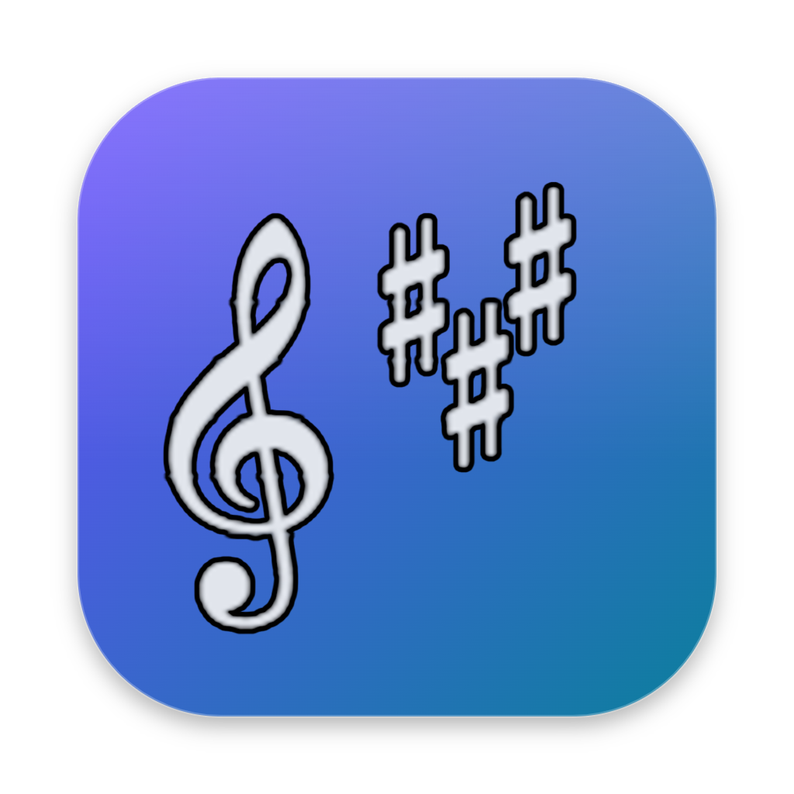

# Buzzz Midi Player



A MIDI player for practicing vocal parts. Open a MIDI file, pick the part you're learning, and
the player shows it as sheet music while the whole arrangement plays, at the tempo you choose.
The other parts keep playing with their own volume, pan and sound, so you can turn your own part
up, mute it to sing along, or loop the bars you're working on.

## Features

- **Practice one part:** the chosen track is shown as sheet music or as a piano roll that
  follows playback; solo or mute it with one click.
- **Mixer:** volume, pan, mute, solo and instrument per track, with level meters and reset
  buttons for all tracks at once.
- **Tempo:** slow down or speed up (25–200%), and correct the song tempo when a file has it
  wrong.
- **Loops:** loop a range of bars, jump to its start or last bar.
- **MP3 export:** the whole mix, only your part, or everything without your part; the whole
  song or just the loop, played up to 20 times.
- **Key:** read the key with sharps or flats, as major or minor, or use the key estimated from
  the notes when the file's key signature is missing or wrong.
- **Remembers your settings** for each file (mix, tempo, loop, track names, key), and saves or
  loads them as preset files.
- **Recent files** on the start screen and in File > Open Recent.
- **Themes:** Modern, Classic, Old School and Retro, each in light and dark.
- **Update notice:** at startup (and from Help > Check for Updates…) the app asks GitHub for
  the latest release and shows a notice in the top right when a newer version is out. Nothing
  else is sent or collected; offline, it simply shows nothing.

## Installing

Download the installer for your system from the
[releases page](https://github.com/Florian-Heringa/buzzz-midi-player/releases):

| System | File |
|---|---|
| Windows | `buzzz-midi-player-<version>-setup.exe` |
| macOS (Apple Silicon) | `buzzz-midi-player-<version>-mac-arm64.dmg` |
| macOS (Intel) | `buzzz-midi-player-<version>-mac-x64.dmg` |
| Linux | `…-linux-x86_64.AppImage` (any distribution) or `…-linux-amd64.deb` (Debian, Ubuntu) |

The installers are not signed yet, so the system asks before running the app the first time:

- **Windows:** SmartScreen says "Windows protected your PC". Click **More info**, then **Run anyway**.
- **macOS:** the app is blocked on first open. Open **System Settings > Privacy & Security**,
  scroll down and click **Open Anyway** next to Buzzz Midi Player. If macOS says the app
  is damaged, run `xattr -cr "/Applications/Buzzz Midi Player.app"` in Terminal and open
  it again.
- **Linux:** make the AppImage executable (`chmod +x`, or Properties > Permissions), then run it.
  On recent distributions AppImages need FUSE 2 (Ubuntu 22.04 and later:
  `sudo apt install libfuse2`, or `libfuse2t64` on 24.04); the `.deb` doesn't.

## Development

Requires Node.js 22 or newer.

```sh
npm install
node node_modules/electron/install.js   # only if `npm install` skipped the Electron download
npm run fetch-soundfont                 # downloads GeneralUser GS into resources/soundfonts/
npm run dev
```

| Script | What it does |
|---|---|
| `npm run dev` | Start the app with hot reload |
| `npm test` | Unit tests (vitest); the MP3 render test is skipped without the SoundFont |
| `npm run smoke` | Build, then drive the app with Playwright: playback, mixer, notation, presets, export |
| `npm run typecheck` / `npm run lint` | Static checks |
| `npm run make-samples` | Regenerate `samples/satb-chorale.mid` |
| `npm run make-icon` | Regenerate the app icon `resources/icons/icon.png` from `resources/icons/logo.png` |
| `npm run build:dir` | Package an unpacked app for this system into `dist/` |
| `npm run build:win` / `build:mac` / `build:linux` | Build that system's installers into `dist/` (each only builds on its own system) |

To run the smoke test against a packaged app instead of the development build, set
`APP_EXECUTABLE`, e.g. `APP_EXECUTABLE="dist/win-unpacked/Buzzz Midi Player.exe" node scripts/drive.mjs`.

### Releasing

Installers are built by GitHub Actions (`.github/workflows/release.yml`) on Windows, macOS and
Linux:

1. Set the new `version` in `package.json` and commit it.
2. Tag the commit with that version and push: `git tag v0.2.0 && git push origin main v0.2.0`.
3. The workflow runs the checks, builds the installers and attaches them to a **draft** release.
   Review it on GitHub and publish it.

To test the installers without releasing, run the workflow by hand (Actions > Release > Run
workflow); the installers are then downloadable from the run's artifacts.

### How it works

- **Song model** (`src/renderer/src/model`): MIDI files are parsed with `midi-file` into tracks
  (a track using several channels is combined or split per channel, a setting), a tempo map and
  time/key signatures.
- **Playback** (`src/renderer/src/audio`): FluidSynth (WASM, via `js-synthesizer`) runs in an
  AudioWorklet and plays a generated MIDI file with one synth channel per track. Volume, pan and
  instrument are applied live; a small worklet hook (`worklet/mixerHook.js`) keeps them in effect
  after FluidSynth's player resets the synth on play and seek.
- **Notation** (`src/renderer/src/notation`): the piano roll is an SVG drawn from note pitches and
  times. Sheet music is built from the track (`sheet/sheetModel.ts`: quantizing, bars, ties,
  rests, accidentals) and drawn with VexFlow on one scrolling line; notes get room for their length
  growing less than in proportion, never less than their symbols need.
- **Export** (`src/main/export`): the same generated MIDI (cut to the loop and repeated, if chosen)
  is rendered offline by FluidSynth in a Node worker thread and encoded with lamejs.
- **Settings** are auto-saved per MIDI file in the app's user data folder and can be saved to or
  loaded from `.json` preset files.

## License

MIT, see [`LICENSE`](LICENSE). The app includes FluidSynth (LGPL-2.1), lamejs (LGPL-3.0), VexFlow
with the Bravura font (MIT, SIL OFL), the GeneralUser GS SoundFont and other components under
their own licenses: see [`THIRD_PARTY_NOTICES.md`](THIRD_PARTY_NOTICES.md), also under
Help > Third-Party Licenses in the app.
